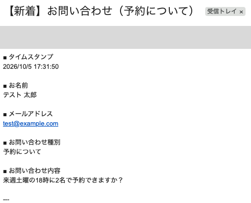
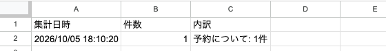

# 問い合わせフォーム 自動通知・日次集計ツール（Google Apps Script）

Googleフォームに届いた問い合わせを、**すぐにメールで知らせ**、**毎朝その日の件数をまとめて届ける**ツールです。

「フォームの回答をいちいちスプレッドシートまで見に行くのが面倒」「問い合わせに気づくのが遅れる」といった悩みを解消します。

## できること

| 機能 | 内容 |
|---|---|
| 新着通知 | 回答が届いた瞬間に、回答内容をまとめたメールを送信 |
| 日次集計 | 毎朝8時に、過去24時間の件数を種別ごと（予約・商品など）に集計してメール送信 |
| 集計の記録 | 集計結果を「日次集計」シートに1日1行で蓄積し、あとから推移を確認できる |

### 新着通知メール

回答内容がそのまま届くので、スプレッドシートを開かなくても内容を確認できます。

### 日次集計シート

毎朝の集計結果が1日1行で記録されます。

## 使用技術

- Google Apps Script（JavaScript / V8）
- Googleフォーム、Googleスプレッドシート、Gmail（MailApp）
- インストール型トリガー（フォーム送信時・時間主導型）

## セットアップ（10分ほど）

1. Googleフォームを作り、次の質問を用意する
   - お名前（記述式）
   - メールアドレス（記述式）
   - お問い合わせ種別（ラジオボタン：商品について / 予約について / その他）
   - お問い合わせ内容（段落）
2. フォームの「回答」タブ →「スプレッドシートにリンク」で回答先シートを作る
3. そのスプレッドシートで「拡張機能」→「Apps Script」を開く
4. `Code.gs` の中身を貼り付けて保存する
5. 関数 `setupTriggers` を選んで「実行」し、権限を許可する
6. 関数 `testNotify` を実行し、テストメールが届くことを確認する

これで、以降はフォームに回答が来るたびに自動で動きます。

## 設定の変更

`Code.gs` 冒頭の `CONFIG` を書き換えるだけで調整できます。

| 項目 | 説明 | 初期値 |
|---|---|---|
| `NOTIFY_EMAIL` | 通知先アドレス（空なら実行者のアドレス） | 空 |
| `RESPONSE_SHEET` | 回答が入るシート名 | `フォームの回答 1` |
| `SUMMARY_SHEET` | 集計を記録するシート名 | `日次集計` |
| `CATEGORY_QUESTION` | 種別ごとに集計する質問のタイトル | `お問い合わせ種別` |
| `DAILY_HOUR` | 日次集計を送る時刻 | `8` |

> **注意**：`CATEGORY_QUESTION` は、フォームの質問タイトルと**一字一句同じ**にしてください（「お問い合わせ」と「お問い合せ」の違いでも一致しません）。一致しないと、すべての回答が「未分類」として集計されます。

## 工夫した点

- **設定を1か所にまとめた**：コードを読めない方でも、`CONFIG` だけ触れば通知先や時刻を変えられる
- **`setupTriggers` は何度実行しても安全**：既存のトリガーを消してから作り直すので、二重通知が起きない
- **テスト用関数を用意**：実際にフォームを送信しなくても、通知メールの見た目を確認できる
- **質問の追加・削除に強い**：通知メールは質問タイトルをそのまま使うので、フォームを変えてもコードの修正が不要
